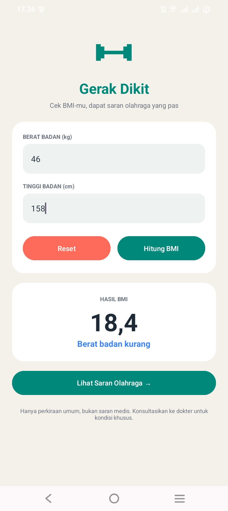
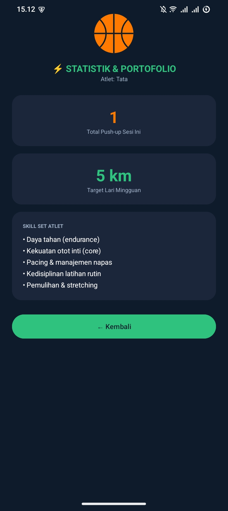

Gerak Dikit 🏋️

Aplikasi Kalkulator BMI dan Rekomendasi Olahraga — Pemrograman Mobile

Gerak Dikit adalah aplikasi Android yang membantu pengguna menghitung Body Mass Index (BMI) berdasarkan berat dan tinggi badan, kemudian menampilkan rekomendasi aktivitas olahraga.

✨ Fitur Aplikasi

- Menghitung BMI berdasarkan berat badan dan tinggi badan.
- Menampilkan nilai BMI beserta kategorinya.
- Memberikan rekomendasi olahraga mingguan.
- Menampilkan target aktivitas fisik mingguan.
- Mempertahankan data BMI saat Activity mengalami perubahan konfigurasi melalui `onSaveInstanceState`.

🎨 Tampilan Aplikasi

1. Halaman Kalkulator BMI
Menampilkan input berat badan, tinggi badan, hasil BMI, dan tombol untuk melihat rekomendasi olahraga.

2. Halaman Saran Olahraga
Menampilkan rekomendasi aktivitas fisik dan target aktivitas mingguan.

🛠️ Teknologi

- Kotlin
- Android SDK
- Gradle
- XML Layout

🔄 Activity Lifecycle

Pengujian dilakukan dengan membuka aplikasi, menekan tombol Home, dan membuka kembali aplikasi.

Callback yang diamati melalui Logcat meliputi:

- `onStart()`
- `onResume()`
- `onPause()`
- `onStop()`
- `onRestart()`
- `onSaveInstanceState()`

📱 Intip Gerak Dikit

<table>
  <tr>
    <td align="center">
      <strong>🧮 Kalkulator BMI</strong> 
      
    </td>
    <td align="center">
      <strong>🏃 Saran Olahraga</strong> 
      
    </td>
  </tr>
</table>

 🔄 Activity Lifecycle

  

🚀 Cara Menjalankan

1. Clone repository ini ke laptop.
2. Buka folder proyek di Android Studio.
3. Tunggu sampai Gradle Sync selesai.
4. Hubungkan HP atau nyalakan emulator.
5. Klik **Run ▶** dan Gerak Dikit siap dicoba!

🎯 Project Goals

Mempraktikkan pengembangan aplikasi Android, pembuatan antarmuka, perhitungan BMI, dan pengamatan Activity Lifecycle.

Small steps, big progress. Yuk, gerak dikit! 💚
